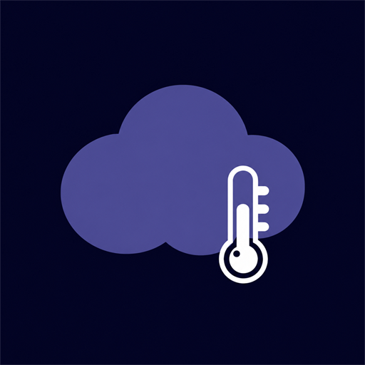
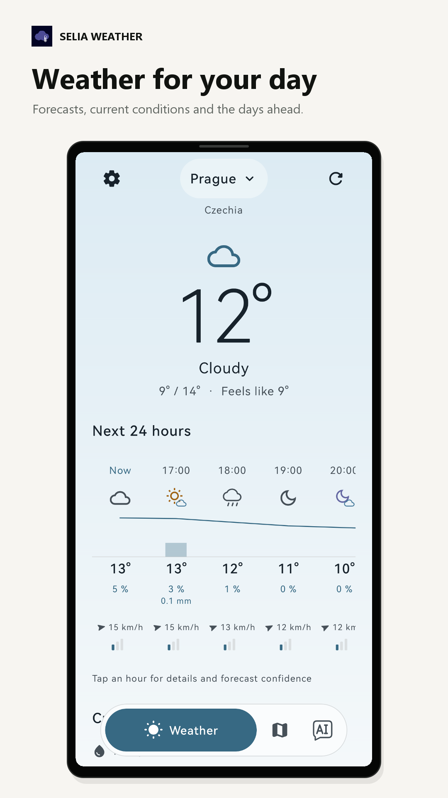
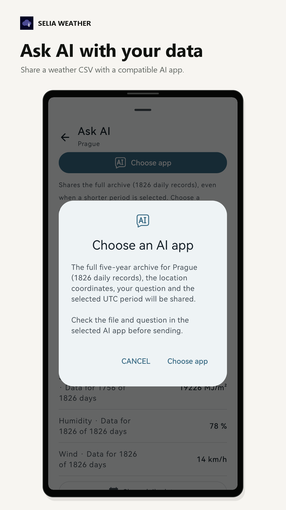
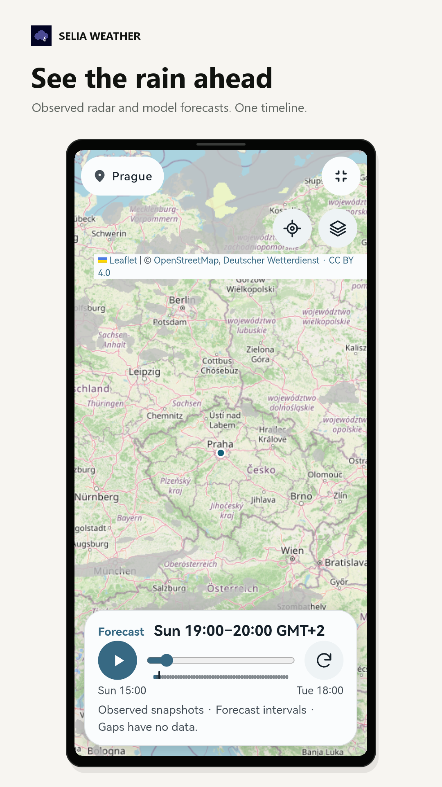
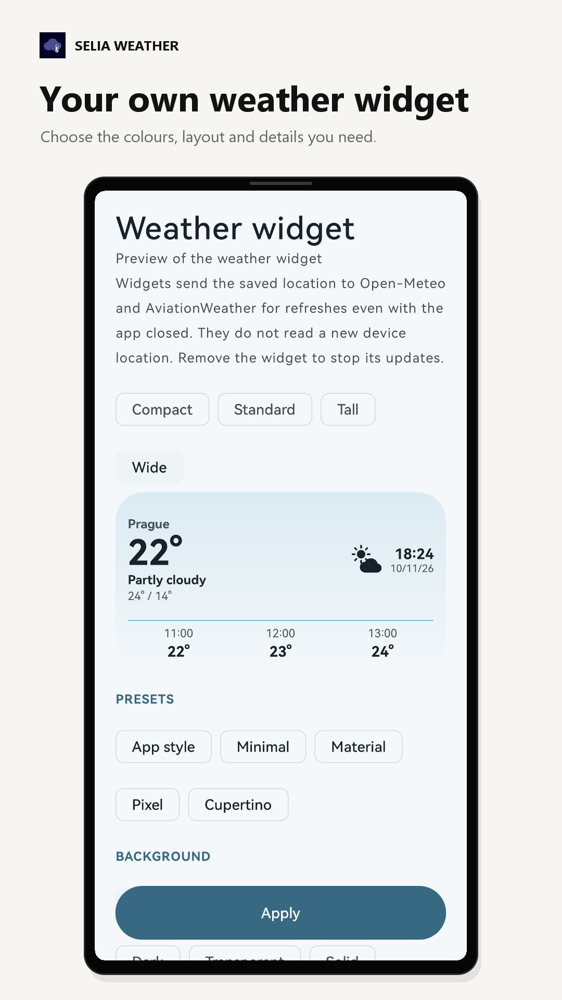

<p align="center">
  
</p>

<h1 align="center">Selia Weather</h1>

<p align="center">A focused worldwide Android weather app with regional model routing, observed radar, and an adaptive widget.</p>

<p align="center">
  <a href="https://github.com/Majkey25/Selia-Weather/actions/workflows/android.yml"></a>
  <a href="https://github.com/Majkey25/Selia-Weather/releases/latest"></a>
  
  <a href="LICENSE"></a>
</p>

<p align="center">
  
  &nbsp;&nbsp;
  
  &nbsp;&nbsp;
  
  &nbsp;&nbsp;
  
</p>

## What it does

- Shows current and apparent temperature, dew point, wet-bulb temperature, precipitation, cloud layers, visibility, pressure, wind, sun, and Moon details.
- Adds UV, freezing-level, boundary-layer, atmospheric-water, instability, showers, and ground details.
- Opens a MapLibre map in Forecast mode, with a separate Observed switch for RainViewer coverage. Official DWD grids provide hourly ICON-EU totals in Europe and six-hour ICON totals elsewhere, targeting a 48-hour outlook. It labels snapshots and forecast accumulation intervals separately and preserves the selected time during refresh. Missing or stale data stays unavailable. Forecast totals are not observed future radar.
- Shows a horizontal 24-hour outlook and a four-day preview expandable to the full 14-day forecast. Weather details and history sit below the daily overview. Each day opens its hourly details and a short weather summary.
- Supports independent Android notification categories for rain advice, cold, temperature drops, heat, wind, UV and official warnings. Thresholds are configurable; background delivery is best effort.
- Matches official warnings to Czech locations through ČÚZK/ČHMÚ and US locations through NWS point queries. UK and other unsupported feeds are explicitly marked unavailable, with links to official sources. The app does not replace emergency-alert systems.
- Hourly precipitation is shown for the interval starting at the row label: 11:00 means 11:00–12:00. Amounts, probability and model spread use that interval's source data; temperature and sky conditions keep their displayed timestamp. Missing intervals remain unavailable.
- Opens a five-year NASA POWER archive with 15 daily metrics. Select 30 days, 365 days, all data, or custom dates to calculate totals and coverage locally. After confirmation, Ask AI lists compatible installed apps using their Android labels, plus an Android CSV export fallback. It shares the full provenance-labelled CSV and your question in the app language. The recipient controls whether it accepts the attachment; check it before sending.
- Searches places worldwide, stores favourites, can use your optional current location, and can save an exact named point on an interactive world map or by coordinate.
- Uses nearby ČHMÚ stations in Czechia and METAR reports worldwide for available current measurements. Point-weather corrections require reports within 10 km and 30 minutes; nearby weather can still differ from the selected point. Ten-minute station totals do not replace model precipitation amounts or hourly forecasts.
- Preserves explicit drizzle reports, does not infer clear skies from sunshine duration, and distinguishes total cloud observations from partial-height airport reports. METAR observations never invent a precipitation amount.
- Expanded hourly details show the number of models with nonzero precipitation totals and their amount range. These are descriptive model counts, not a calibrated probability.
- Each forecast day and hour shows High, Medium, Low, or Not rated confidence. The estimate uses complete model-input agreement, lead time and download age. Nearby dry-sky categories use cloud-cover spread instead of treating a threshold crossing as a large disagreement. Tap a confidence chip for the ranges and limits. It is not a probability of accuracy, and missing inputs stay explicit.
- Keeps the last successful forecast for offline display.
- Includes a resizable launcher widget with per-widget colours, transparency, gradient or custom-image backgrounds, text scale, alignment, custom label, and selectable weather fields.
- Supports Metric and Imperial display units in the app and widgets.

## Forecast data and accuracy

The base forecast uses Open-Meteo Best Match worldwide. The app also requests verified provider-family series and calculates a robust median on the device when at least three values are available. Provider seamless series use local high-resolution grids inside their domains and global output elsewhere. Czech locations additionally request CHMI ALADIN. Suspended providers are excluded.

Hourly cloud layers use the same contributing models as the total-cloud median. Missing selected layers stay unknown. Provider-specific layer definitions are preserved; they are not forced into a geometric union formula.

The app normally uses the diagnostic median or Best Match. Provider precipitation probability is preserved: agreement among deterministic models is not a calibrated probability. Learned weights require a validated production feed, individual model issue times and a matching regional holdout; the published feed is currently diagnostic. The research exporter rejects weights outside their evaluated region, season, or forecast lead. Weather details show the actual mode and contributors; no superior-accuracy claim is made.

The evidence and limits are recorded in [Global model routing](docs/research/global-model-routing.md), [Worldwide ensemble validation](docs/research/worldwide-ensemble-validation.md), and the [313-case temperature replay](docs/research/2026-09-05-temperature-replay.md). That replay improves pooled error over Best Match but contains station-level failures and is not a new holdout.

The [research workflow](research/README.md) can freeze future forecasts and later compare them with independent station observations. Missing truth stays unscored. [WeatherNext 3](docs/research/weathernext-3-review.md) is under review, not integrated; access and production-use permission remain prerequisites.

- [Open-Meteo Forecast API](https://open-meteo.com/en/docs)
- [NASA POWER Daily API](https://power.larc.nasa.gov/docs/services/api/temporal/daily/)
- [NASA POWER referencing guide](https://power.larc.nasa.gov/docs/referencing/)
- [AviationWeather worldwide METAR API](https://aviationweather.gov/data/api/)
- [NOAA ISD](https://www.ncei.noaa.gov/products/land-based-station/integrated-surface-database)
- [NASA GPM IMERG](https://gpm.nasa.gov/data/imerg)
- [RainViewer Weather Maps API](https://www.rainviewer.com/api/weather-maps-api.html)
- [ČHMÚ current station data](https://opendata.chmi.cz/meteorology/climate/now/)
- [ČHMÚ open weather data](https://opendata.chmi.cz/meteorology/weather/)

The historical data was obtained from the NASA Langley Research Center POWER project funded through the NASA Earth Science Division. CSV exports include the POWER Daily API version and access time. Selia Weather is not an official NASA, ČHMÚ, or Open-Meteo app.

## Background notifications

Choose a daily time in **Settings → Notifications → Morning briefing**. The forecast is prepared beforehand and a native alarm can deliver cached advice with the app closed. Missed briefings expire after 30 minutes. **Rain and umbrella** has a separate lead time, default one hour, and probability threshold. Cached rain alarms run alongside the persisted forecast-refresh job.

On Android 12+, **Background delivery → Allow timely alerts** opens Alarms & reminders access. Android controls execution timing and can delay work during Doze or manufacturer battery restrictions. After Force stop, reopen the app to resume work. See [Android alarm scheduling](https://developer.android.com/develop/background-work/services/alarms/schedule).

## Language and requirements

Selia Weather supports Android 10 and later. It follows the Android system language by default. English is the fallback for unsupported system languages. You can select English, Czech, German, Spanish, or French in the app.

Settings groups language, units, notifications, official warnings, appearance, widgets, and support into separate menus. Swipe left through Weather, Radar, and Ask AI, or right to return. On Radar, swipe the header to change tabs. Drags on the map pan the map, and fullscreen keeps all gestures in Radar.

Appearance follows System, Light, or Dark mode, with independent theme choices for light and dark. Choose weather-reactive colours, fixed gradients, Material, Minimal, AMOLED, or a custom HEX palette. Native Material You colours are available on Android 12+. Font style, text size and corner radius are adjustable; custom colours require readable contrast. App-style widgets and radar controls follow the choice.

The public application ID is `com.majkeylab.weatheraladin`. A network connection is required for fresh forecasts, search, and radar. Build locally with JDK 17 and Android SDK 36.

## Widget

One stable widget layout adapts to compact, standard, wide, and tall sizes. Resize it horizontally or vertically. Each widget stores its own configuration, so two widgets can use different colours, fields, labels, and backgrounds.

Choose App style to follow the app's appearance setting, or start from Minimal, Material, Pixel, or Cupertino. Adjust fonts, text scale, alignment, corner shape, content spacing, colours, and background opacity independently.

Choose a date format for each widget: system default, `8.9.2026`, `08.09.2026`, ISO, a localized month name, or a custom Java date pattern. The editor previews the result and rejects invalid patterns. The clock can follow the system or use 12-hour or 24-hour time independently.

Tap a colour swatch to open the HEX/RGB/opacity picker. Automatic text contrast handles opaque backgrounds; editing a text colour switches to manual control. Transparent or image backgrounds depend on your wallpaper and need a home-screen readability check.

Compact widgets prioritize a readable temperature. They can reduce displayed text size, hide secondary content, or reduce spacing when needed. Your saved choices remain available when you enlarge the widget.

For a custom background, the editor asks Android to grant access to the selected image. The widget keeps only the image URI. It decodes a bounded copy when it renders. If the URI becomes unavailable or takes more than five seconds to read, the widget uses its configured colour background. A stalled provider stays isolated from widget updates; custom images fall back until the reader becomes available again.

## Support

GitHub APKs include an optional [Buy Me a Coffee](https://www.buymeacoffee.com/majkey) link in settings. It opens in Android's external browser. Support does not unlock features, give priority, or change the app. Google Play builds omit this action and use separate [payment-free legal information](https://majkey25.github.io/Selia-Weather/play.html).

## Monetisation status

Release builds do not contain or initialise Ads, UMP, Play Billing, Premium, or `AD_ID`. Debug-only QA builds keep optional test integrations outside the release dependency graph. Monetisation can return only after the app uses a commercially licensed forecast path and the public disclosures are updated.

## Build

```powershell
.\gradlew.bat :app:testDebugUnitTest :app:lintDebug :app:assembleDebug --console=plain
```

The debug APK is at `app/build/outputs/apk/debug/app-debug.apk`.

`distributionChannel` defaults to `play`. Build Google Play bundles with `-PdistributionChannel=play :app:bundleRelease`. Build GitHub APKs with `-PdistributionChannel=github :app:assembleRelease`, or use `-PdistributionChannel=github :app:assembleDebug` for an installable debug APK. The GitHub channel cannot build app bundles. CI tests both channels and uploads the GitHub debug APK; signing identities and application IDs are unchanged.

To publish documentation when an upstream forecast fails validation, run `gh workflow run forecast-data.yml --ref main -f include_forecasts=false`. This manual mode publishes an empty diagnostic feed alongside the privacy page. Default forecast runs still require valid data; this does not enable production calibration.

## Privacy

The app has no developer account or separate analytics SDK. It keeps the selected place, favourites, widget settings, forecast cache, and a bounded history cache in internal app storage. Current location is optional. Forecast coordinates are sent to Open-Meteo. A bounded coordinate box is sent to AviationWeather to find nearby METAR reports, including in Czechia. The observed map loads visible OpenStreetMap and RainViewer tiles; the future map loads DWD forecast tiles. After you select **Weather history** or **Load archive**, the selected coordinates are sent to NASA POWER when the archive needs a refresh. A history CSV leaves the app only after you confirm **Ask AI with CSV** and choose a compatible recipient through Android's system share sheet. The app does not authenticate the recipient's publisher or upload a list of installed apps. In Czechia, the app selects nearby ČHMÚ station IDs locally and requests their public observation files without sending the selected coordinates to ČHMÚ. Read the [privacy policy](https://majkey25.github.io/Selia-Weather/).

## Status

The app uses the product identity Selia Weather and the short launcher label Weather. It keeps the public package `com.majkeylab.weatheraladin`, so existing Play installations update normally. The GitHub Latest link points to stable builds; prereleases remain available for testing. Published calibration remains diagnostic until its source, provenance and holdout checks pass. Google Play uses a separate private upload key and Play App Signing.

## Legal information

Developer and privacy contact: Matěj Teplý (Majkey25), [majkeylab@gmail.com](mailto:majkeylab@gmail.com).

- [Privacy policy](https://majkey25.github.io/Selia-Weather/)
- [Terms of use](https://majkey25.github.io/Selia-Weather/terms.html)
- [Payments and refunds](https://majkey25.github.io/Selia-Weather/refunds.html)
- [Cookies and storage](https://majkey25.github.io/Selia-Weather/cookies.html)

The legal pages use local assets, keyboard navigation and visible focus indicators, with no tracking scripts or consent banner for nonexistent cookies. [Review evidence and unresolved requirements](docs/legal-audit-2026-09-08.md) distinguish implemented disclosures from legal and accessibility certification; no global compliance claim is made.

## License

Source code is available under the [MIT License](LICENSE). Bundled MapLibre uses [BSD-3-Clause](app/src/main/assets/maplibre-6.14.0/LICENSE.txt). Weather data and radar remain subject to their providers' terms.
